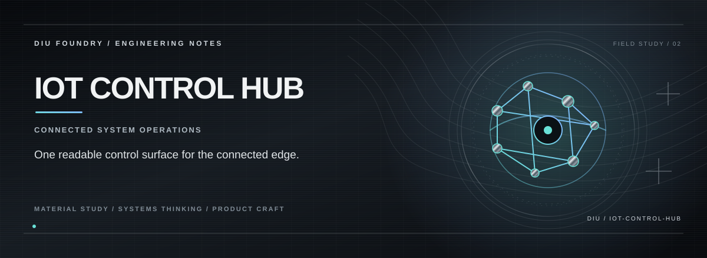

> **SECURE DEVICE OPERATIONS.**

## THE PREMISE

IoT Control Hub turns a connected-device fleet into an operator-facing control surface: state first, actions second, and security context visible instead of hidden behind the UI.

## THE EXPERIENCE

**Observe the fleet at a glance.**  
**Control only what the system permits.**  
**Keep realtime state close to the operator.**

## THE SYSTEM

The frontend is built around React/TypeScript with Supabase-backed flows, Socket.IO-ready realtime transport, Recharts for operational signals, and Framer Motion for state transitions.

## THE STACK

React 18 · TypeScript · Vite · Supabase · Socket.IO · Recharts · Framer Motion · Tailwind CSS

## RUN

Requirements: Node.js and npm.

```bash
npm ci
npm run dev
```

Vite prints the development URL. Before shipping, run:

```bash
npm run build
npm run lint
npm test
```

Supabase configuration, when used, belongs in a local ignored environment file; never commit service-role credentials.

## PROJECT STATE

**Prototype / security-platform development**

The repository documents the capabilities that are actually implemented; future integrations are intentionally separated from the current product surface.

---

<p align="center"><strong>K. KISHOR KUMAR</strong><br><sub>ENGINEERING / PRODUCT / SYSTEMS</sub></p>
